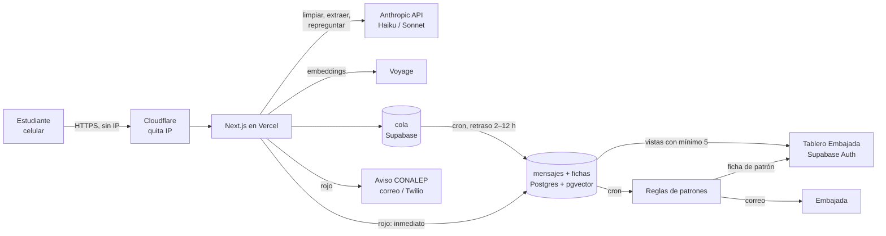

# eco: guía de desarrollo

> Para quien va a construir eco. Traduce la especificación a un plan de trabajo: qué hay hoy, qué falta, en qué orden y qué no se puede romper.
>
> Fuente de verdad del producto: [`docs/especificacion.md`](especificacion.md) (v1.1). Si este documento y la especificación dicen cosas distintas, manda la especificación y hay que avisar para corregir esto.
>
> Versión 1 · 19 de octubre de 2026 · StartupLab MX

---

## 1. De qué se trata

**eco** es un canal anónimo para estudiantes de CONALEP. Lo encarga la Embajada de Estados Unidos en México y lo desarrolla StartupLab MX. El piloto es en un plantel de la Zona Metropolitana del Valle de México.

El problema: el crimen organizado recluta adolescentes cerca de las escuelas, y el reclutamiento pasa por etapas que se pueden ver (contacto → oferta → tarea de prueba → enganche → amenaza). Muchas personas en el plantel ven algo, pero nadie lo dice y cada quien cree que es la única que sabe.

eco hace tres cosas:

1. **Para el estudiante:** una página web sin cuenta donde cuenta lo que vio o le pasó, con sus palabras. Al terminar recibe una señal de que no está sola ni solo: *"6 personas más contaron algo parecido cerca de tu plantel este mes"*. Antes de contar nada ve un **radar**: cuántas personas contaron algo esta semana, en cinco categorías.
2. **Para la Embajada:** un **tablero** con patrones (dónde, cuándo, por qué medio, qué ofrecen, en qué etapa). Nunca muestra mensajes, nombres ni nada que identifique a alguien.
3. **Para CONALEP:** un aviso automático a una persona del plantel cuando un mensaje es grave (rojo).

El canal está abierto a cualquier tema: broncas, maestros, acoso, lo que sea. Nadie escribe "me están reclutando"; escribe "me ofrecieron 4,000 al mes por un jale". La IA clasifica por detrás.

**Lo que no es:** no es un chatbot que aconseja, no tiene personas que contesten, no es un sistema de seguimiento de casos.

---

## 2. Dónde estamos hoy

| | |
|---|---|
| Repositorio | `github.com/startuplab-mx/eco` |
| Rama con el código | **`mockup-demo`**. `main` solo tiene el commit inicial |
| Producción | https://eco-ten-tau.vercel.app (proyecto `eco` en el equipo de Vercel "Pedro M's projects", despliega desde `mockup-demo`) |
| Estado | **Mockup navegable sin funciones**: no hay IA, base de datos ni envíos. El chat sigue reglas por palabras clave y todos los números son inventados |
| Stack actual | Next.js 16.3 (App Router), React 19, Tailwind 4, TypeScript, `lucide-react` |

### Correrlo

```bash
git clone https://github.com/startuplab-mx/eco && cd eco
git checkout mockup-demo
npm install
npm run dev      # http://localhost:3000  ·  /demo tiene el guion de 10 minutos
npm test         # 426 casos del chat
npm run simular -- "un wey afuera nos ofreció lana" "en la parada"
```

> ⚠️ **Next.js 16 cambió APIs y convenciones.** Antes de escribir código, revisar `node_modules/next/dist/docs/` (ver `AGENTS.md`). No confiar en lo que uno recuerda de Next 13/14.

### Qué hay en el mockup

| Ruta | Quién | Qué |
|---|---|---|
| `/` | Estudiante | Radar: cinco filas, conteo semana/mes, botón "Contar algo" |
| `/contar` | Estudiante | Chat: máximo dos repreguntas y cierre |
| `/salir` | Estudiante | Página neutra (apuntes de física) para la salida rápida |
| `/tablero/entrar` | Embajada | Login (falso) |
| `/tablero/*` | Embajada | Resumen, mapa, canales, modo de operar, alertas, respuesta, léxico, accesos |
| `/demo` | Quien presenta | Guion del demo |

Archivos clave:

- `config/textos.json`: todos los textos que ve el estudiante (borrador).
- `config/taxonomia.json`: categorías que usa la IA (v0.2, la valida la Embajada).
- `config/lexico.json`: jerga → significado → categoría.
- `lib/mock/conversacion.ts`: motor de repreguntas por palabras clave. **Es la referencia del comportamiento esperado, no el producto.**
- `lib/mock/conversacion.test.ts` + `lib/mock/revision/*.mjs`: **426 casos** de prueba del chat. Son el set de evaluación de la IA real.
- `lib/mock/tablero.ts`, `lib/mock/estudiante.ts`: datos sintéticos con la forma que deben tener los datos reales.
- `docs/repreguntas.md`: reglas detalladas de cuándo preguntar qué.
- `docs/revision-chat.md`: lo que se aprendió probando el chat.

---

## 3. Reglas que no se rompen

Esto va antes que cualquier funcionalidad. Si algo choca con estas reglas, no se construye. Están también en `CLAUDE.md`.

**Anonimato**

1. **No se protege la identidad: no se tiene.** Nunca guardar IP, user agent, cookies, identificadores de dispositivo ni huella del navegador. Tampoco en logs.
2. **La hora no existe en los datos de mensajes.** Se guarda fecha + franja (matutino, vespertino, noche, fin de semana). Nunca un timestamp exacto.
3. **El texto original nunca toca el disco.** Se limpia en memoria y solo se persiste la versión limpia.
4. **Sin código de seguimiento.** Nada liga a quien escribe con su mensaje, ni un código guardado en el celular.
5. **Lugar por celdas gruesas** que elige el estudiante (entrada, parada, colonia…). Jamás GPS ni permisos del navegador.
6. **Los mensajes no rojos entran a la base en lotes con retraso aleatorio de 2 a 12 horas.** Los rojos entran de inmediato.

**Salida de datos**

7. **Mínimo 5.** Ninguna consulta agregada devuelve celdas o filas con menos de 5 registros. Se aplica en la base de datos, no solo en la interfaz.
8. **El tablero nunca muestra texto libre, mensajes individuales, `actor_nombre` ni horas exactas.** Tampoco permite exportar por renglón.

**Comportamiento del chat**

9. El chat **no da consejos, no pide nombres ni datos de quien escribe, no califica ("eso es reclutamiento") y no promete acción.**
10. Los únicos textos hacia el estudiante salen de `config/textos.json`, más las repreguntas de campos faltantes.
11. **Ante duda en gravedad, se clasifica hacia arriba.** El único error grave es tratar un rojo como broma.
12. **La broma no se castiga.** Nunca se le dice a alguien que su mensaje se descartó.
13. **Nunca se le dice a alguien que es la primera persona en contar algo.** Si no hay parecidos, se le da el total de su plantel.
14. **Lenguaje:** español de México, sin masculino genérico hacia quien escribe ("personas", "alguien", "estudiantes"). Tampoco "compas", "otros 6" ni "no vayas solo".
15. **El reclutamiento no es solo de chavos.** Toda categoría y dato cubre también las vías que afectan más a chavas: "novio" o relación con un adulto mayor, regalos, fotos, "trabajo de modelo", fiestas, trata.

**Configuración**

16. Taxonomía, léxico, celdas y textos viven en `/config` y no se escriben en el código.

---

## 4. Arquitectura



Un solo proyecto Next.js con dos superficies:

- **Lado estudiante** (`/`, `/contar`, `/salir`): público, sin cookies, siempre oscuro, sin logos institucionales.
- **Tablero** (`/tablero/*`): con login. **Recomendado:** servirlo en otro subdominio (p. ej. `tablero.<dominio>`) para que las cookies de sesión del tablero nunca existan en el dominio del estudiante.

---

## 5. Flujo de un mensaje, paso a paso

El chat **no guarda estado en el servidor**. La conversación vive en la memoria de la página (React state) y cada turno manda todo lo acumulado. Nada se persiste hasta el cierre.

```
1. Estudiante escribe el primer mensaje
   POST /api/chat  { turnos: ["texto"] }
   └─ servidor, en memoria:
      a. limpiar(texto)          → quita lo que identifica a quien escribe
      b. extraer(texto_limpio)   → ficha preliminar (JSON validado)
      c. si riesgo_inmediato     → cierra ya con bloque rojo (ir al paso 3)
      d. si autolesión           → cierra con bloque de autolesión, sin conteo
      e. si broma/prueba         → cierra con "no se suma" y muestra el radar
      f. repreguntar(ficha)      → siguiente pregunta o null
   ← { texto_limpio, aviso_limpieza?, pregunta? | cierre? }

2. Estudiante responde (máximo dos repreguntas)
   POST /api/chat  { turnos: ["texto", "en la parada", ...] }
   └─ mismo proceso con todo el texto junto

3. Cierre
   └─ servidor:
      a. ficha final + embedding
      b. parecidos = mensajes serios del plantel, últimos 30 días, similitud > umbral
      c. si rojo   → INSERT directo en mensajes/fichas + aviso a CONALEP
         si no     → INSERT en cola con liberar_en = ahora + aleatorio(2h, 12h)
   ← { cierre: "parecidos" | "sin_parecidos" | "no_suma", n, bloque_rojo? }
```

Puntos finos:

- Si se quitó algo en la limpieza, el chat muestra la versión limpia con el texto `limpieza_aviso` de `textos.json`.
- "N personas más" se calcula contra lo que ya está en `mensajes`. El mensaje propio no cuenta, porque todavía está en la cola.
- Las reglas exactas de repreguntas están en [`docs/repreguntas.md`](repreguntas.md): orden de prioridad, cuándo una pregunta no aplica (p. ej. nunca preguntar la hora si fue en línea), "no sé", "prefiero no decir", etc.
- Las opciones rápidas de cada repregunta (botones) están en `lib/mock/conversacion.ts`.
- **Meta de rendimiento:** el flujo completo, del primer mensaje al cierre, en menos de 30 s en un celular.

---

## 6. Stack y servicios

| Pieza | Elección | Notas |
|---|---|---|
| App | Next.js 16 (App Router) + TypeScript + Tailwind 4 | Ya está en el mockup |
| Hosting | Vercel (proyecto `eco` ya creado) | Ver §10 sobre IP y logs |
| Proxy | Cloudflare delante de Vercel | Para quitar la IP antes de la app. Necesario para el piloto; opcional para el demo |
| Base de datos | Supabase: Postgres + pgvector + Auth (tablero) + Storage (capturas) | Región más cercana disponible; cifrado en reposo |
| IA | Anthropic API, SDK `@anthropic-ai/sdk` | `claude-haiku-5-5` por defecto; `claude-sonnet-5-5` cuando la confianza es baja |
| Embeddings | Voyage (modelo multilingüe de 1024 dimensiones; confirmar el vigente) | Anthropic no tiene endpoint de embeddings |
| Validación | `zod` | Esquema de la ficha y de las respuestas de la API |
| Mapa | Componente SVG del mockup (`components/tablero/Mapa.tsx`) | La especificación menciona MapLibre; el mockup resolvió con celdas esquemáticas. Decidir si hace falta mapa real |
| Gráficas | Componentes SVG del mockup (`components/tablero/graficas.tsx`) | Paleta ya validada para daltonismo; no agregar colores sin validarlos |
| Correo | Resend o equivalente | Alertas a la Embajada y aviso a CONALEP en el demo |
| SMS / WhatsApp | Twilio | Solo para el piloto |
| Cron | Supabase `pg_cron` o Vercel Cron | Vercel Cron en plan Hobby corre solo una vez al día; para lotes cada hora hace falta Pro o `pg_cron` |

**Costo de IA:** con Haiku 5.5 ($0.10 / $0.50 por millón de tokens de entrada/salida), un mensaje completo (limpieza + extracción + 1–2 repreguntas) cuesta bastante menos de un centavo de dólar. No hay costo fijo relevante fuera de Supabase y Vercel.

---

## 7. Modelo de datos

Migraciones en `supabase/migrations/`. Punto de partida (afinar tipos y enums contra `config/taxonomia.json`):

```sql
create extension if not exists vector;

create table planteles (
  id text primary key,
  nombre text not null
);

-- Celdas gruesas. Se dibujan a mano con el plantel (config/celdas.geojson).
create table celdas (
  id text primary key,
  plantel_id text references planteles,
  nombre text not null,
  tipo text check (tipo in ('adentro','entrada','parada','colonia','en_linea')),
  geom jsonb                      -- GeoJSON; opcional si el mapa es esquemático
);

-- Cola de liberación con retraso. Se vacía con el cron.
-- Contiene lo mismo que mensajes + fichas; NUNCA el texto original.
create table cola (
  id uuid primary key default gen_random_uuid(),
  liberar_en timestamptz not null,  -- única marca de tiempo; se borra al liberar
  payload jsonb not null            -- { mensaje, ficha, embedding }
);

-- NUNCA: ip, user_agent, timestamp exacto, texto original.
create table mensajes (
  id uuid primary key default gen_random_uuid(),
  plantel_id text not null references planteles,
  celda_id text references celdas,
  fecha date not null,
  franja text not null,
  texto_limpio text,                -- se borra a los 12 meses
  captura_url text,                 -- se borra a los 90 días
  embedding vector(1024),
  creado_en_lote date not null
);

create table fichas (
  mensaje_id uuid primary key references mensajes on delete cascade,
  quien_habla text, hechos text[], etapa text, es_reclutamiento text,
  medio text, actor text, actor_nombre text,  -- actor_nombre NUNCA sale al tablero
  dirigido_a text, oferta jsonb, gravedad text, riesgo_inmediato boolean,
  seriedad text, fila_radar text, confianza jsonb, resumen text,
  modelo text, version_taxonomia text
);

create table hechos_agrupados (
  id uuid primary key default gen_random_uuid(),
  plantel_id text, celda_id text, fecha_inicio date, fecha_fin date,
  n_testigos int, ficha_representativa uuid
);

create table patrones (
  id uuid primary key default gen_random_uuid(),
  regla text, plantel_id text, celda_id text, periodo text,
  ficha jsonb,                      -- ficha de patrón: sin texto libre ni nombres
  estado text default 'nueva',      -- nueva | revisada
  creado_en date default current_date
);

create table lexico_propuestas (
  termino text primary key, n_apariciones int, primera_vez date,
  estado text default 'pendiente'   -- pendiente | aprobado | descartado
);

create table avisos (               -- para la vista "Respuesta institucional"
  id uuid primary key default gen_random_uuid(),
  plantel_id text, fecha date, canal text, estado text,
  minutos_hasta_aviso int
);

create table accesos (              -- registro que se entrega a CONALEP
  usuario text, vista text, fecha date, franja text
);

create index on mensajes using hnsw (embedding vector_cosine_ops);
```

### Seguridad en la base

- **RLS activado en todas las tablas.**
- El rol del tablero (`embajada`) **no puede leer** `mensajes`, `fichas` ni `cola`. Solo lee **vistas agregadas** y `patrones`.
- Las vistas agregadas aplican el mínimo de 5 en SQL. Por ejemplo:

```sql
create view radar_semana as
select m.plantel_id, f.fila_radar,
       case when count(*) >= 5 then count(*) end as n   -- null → "—" en la UI
from mensajes m join fichas f on f.mensaje_id = m.id
where f.seriedad = 'serio'
  and m.fecha >= date_trunc('week', current_date)
group by 1, 2;
```

- Las escrituras desde la API usan la service key **solo en el servidor**, nunca en el cliente.
- Retención con un job diario: `texto_limpio` a null después de 12 meses, capturas borradas después de 90 días. Fichas y agregados se conservan.

---

## 8. API

| Ruta | Método | Quién | Qué hace |
|---|---|---|---|
| `/api/chat` | POST | Estudiante | Recibe los turnos y devuelve la siguiente pregunta o el cierre (ver §5). Sin estado |
| `/api/radar?periodo=semana\|mes` | GET | Estudiante | Cinco filas + total, con mínimo 5. Cacheable unos minutos |
| `/api/captura` | POST | Estudiante | Sube la captura ya limpia de metadatos. Opcional para el demo |
| `/api/cron/liberar` | POST | Cron | Mueve de `cola` a `mensajes`/`fichas` lo que ya pasó su `liberar_en` |
| `/api/cron/patrones` | POST | Cron | Corre las reglas de §9.6, crea fichas de patrón y manda correo |
| `/api/cron/lexico` | POST | Cron | Detecta términos nuevos (3+ veces en 30 días) |
| `/api/cron/retencion` | POST | Cron | Borra texto y capturas vencidas |
| Tablero | Server components | Embajada | Leen las vistas con la sesión de Supabase; cada vista registra el acceso |

Las rutas de cron se protegen con un secreto en el header (`CRON_SECRET`).

**Reglas para el código de la API:**

- Nunca `console.log` del texto del mensaje, ni original ni limpio. Los logs de Vercel guardan todo.
- Nunca leer ni reenviar `x-forwarded-for`, `x-real-ip`, `user-agent` ni cookies en las rutas del estudiante.
- Las respuestas de error hacia el estudiante son genéricas y amables, y nunca dicen "descartado".

---

## 9. Pipeline de IA

Estructura sugerida (de la especificación):

```
lib/ia/limpiar.ts       quita lo que identifica a quien escribe
lib/ia/extraer.ts       texto → ficha validada contra el esquema
lib/ia/repreguntar.ts   qué falta y cómo preguntarlo
lib/ia/parecidos.ts     embeddings, similitud, dedup
lib/ia/lexico.ts        términos nuevos
lib/patrones/reglas.ts  reglas de alertas
lib/patrones/ficha.ts   arma la ficha de patrón
lib/anonimato/lotes.ts  liberación con retraso
lib/anonimato/capturas.ts  limpieza de metadatos en el cliente
```

### 9.1 Llamadas al modelo

- **Modelo por defecto:** `claude-haiku-5-5`. Si la confianza en `gravedad` o `es_reclutamiento` es menor a 0.7, se repite la extracción con `claude-sonnet-5-5`.
- **Salida estructurada:** usar structured outputs (`output_config.format` con JSON Schema, o `client.messages.parse()` con un esquema `zod`). Así la ficha siempre es válida contra el esquema y no se parsea texto a mano.
- **Esfuerzo:** son tareas de clasificación y extracción, así que conviene probar `output_config.effort: "low"` para bajar latencia. Hay que medirlo contra el set de evaluación antes de fijarlo.
- **Caché de prompt:** el system prompt (instrucciones + taxonomía + léxico) es grande y fijo, así que se pone primero y se marca con `cache_control`. Nada variable (fecha, IDs) va en el system prompt.
- **Negativas del modelo:** si alguna llamada termina con `stop_reason: "refusal"` (posible con temas de violencia sexual o autolesión), se reintenta con Sonnet. Si vuelve a fallar, la ficha queda con `gravedad: rojo` y `seriedad: serio`, por la regla de "ante duda, hacia arriba". El estudiante siempre recibe un cierre normal.
- **Errores de red o de la API:** reintentar. Si de todos modos falla, el mensaje se guarda en la cola con una ficha mínima marcada para reprocesar, y el estudiante recibe un cierre normal. **Nunca se pierde un mensaje** por un error de la IA.

### 9.2 Limpieza (capa 1)

Quita lo que identifica a **quien escribe**: su nombre, apodo, grupo, salón, semestre, matrícula, celular, usuario de redes, "soy el de…". Conserva lo que describe a **terceros** y al hecho. Si el mensaje dice "me dijo soy Toño", "Toño" es un tercero y se queda. El mockup (`limpiar()` en `conversacion.ts`) tiene ejemplos de lo que debe quitar.

### 9.3 Extracción (capa 2)

Produce la ficha. Los campos están en la §5 de la especificación y los valores permitidos en `config/taxonomia.json`. El esqueleto del prompt está en el Anexo C de la especificación. Lo más importante:

- `es_reclutamiento: "probable"` aunque la palabra no aparezca: oferta vaga + insistencia, tarea de prueba, regalos con secreto, pago por avisar, grabar o llevar algo.
- `riesgo_inmediato` solo con cita concreta en tiempo y lugar, amenaza directa, traslado o retención, desaparición, extorsión, violencia sexual o trata. Busca la **combinación de persona y daño**, no palabras sueltas ("me caen mal" no es riesgo; "me caen a la salida" sí).
- `seriedad: prueba/broma` solo si **todo** el mensaje es relleno. "me levantaron" es serio aunque sea corto.
- `dirigido_a` se infiere de lo que cuenta sobre otras personas, **nunca** de quien escribe.
- Devuelve `terminos_nuevos[]` con jerga no reconocida, para el léxico.

### 9.4 Repreguntas

Pregunta solo lo que falta, en este orden: **dónde → cuándo → por qué medio → qué ofrecían**. Máximo dos preguntas. Las reglas completas están en [`docs/repreguntas.md`](repreguntas.md). Las preguntas y las opciones rápidas pueden salir fijas del código (como en el mockup). El modelo solo decide *cuáles* hacer, lo que reduce el riesgo de que el chat "opine".

### 9.5 Parecidos y léxico (capas 3 y 4)

- **Parecidos:** embedding del texto limpio; similitud coseno contra mensajes serios del mismo plantel en los últimos 30 días. El umbral se calibra con los datos sintéticos.
- **Mismo hecho:** muy similares + misma celda + misma franja + ventana de 72 h → un hecho con varios testigos (`hechos_agrupados`).
- **Léxico:** términos de `terminos_nuevos` que aparecen 3+ veces en 30 días → `lexico_propuestas`. La Embajada los aprueba o descarta en el tablero. Al aprobar, se agregan a `config/lexico.json` (por PR o desde la base; decidir).

### 9.6 Reglas de patrones (capa 5)

| Regla | Condición |
|---|---|
| Concentración | 8+ mensajes serios en la misma celda en 7 días |
| Coincidencia | 3+ testigos independientes de una misma cita (lugar + franja + fecha) |
| Escalamiento | La proporción tarea+amenaza sobre contacto+oferta crece 2× entre periodos en una celda |
| Medio nuevo | Una plataforma o término aparece por primera vez y se repite 3+ veces |
| Oferta replicada | Misma oferta (tipo + monto ± 20 %) en más de un plantel |
| Actor persistente | Mismo descriptor de actor en 5+ mensajes en 3+ semanas |

Cada regla produce una **ficha de patrón**: zona, periodo, reportes independientes, medio, oferta, monto típico, franja, etapa predominante, escalamiento y confianza. Sin texto libre ni nombres. Ver el pendiente 1 de §14 sobre conteos menores a 5.

### 9.7 Evaluación (obligatoria antes de conectar la página)

Los **426 casos** de `lib/mock/conversacion.test.ts` y `lib/mock/revision/` dicen qué debe pasar con cada mensaje: clase (serio, rojo, autolesión, broma), qué preguntas hacer y qué limpiar. Hay que:

1. Escribir un runner (`scripts/evaluar.ts`) que pase cada caso por el pipeline real y compare.
2. Reportar aciertos por categoría. **Los rojos y la autolesión deben salir al 100 %.** Un rojo tratado como broma es el único error inaceptable.
3. Correrlo cada vez que cambie un prompt o el modelo.

---

## 10. Anonimato técnico

| Tema | Cómo |
|---|---|
| **IP** | Vercel ve la IP y la guarda en sus logs. Para el piloto, poner Cloudflare como proxy con la transformación administrada **"Remove visitor IP headers"** activada, para que Vercel solo vea IPs de Cloudflare. Desactivar logs de acceso, log drains, Vercel Analytics y Speed Insights. Para el demo con datos sintéticos basta con no loggear nada propio |
| **Cookies** | Ninguna en el lado del estudiante. El tablero en otro subdominio. Sin scripts de terceros (fuentes servidas por `next/font`, sin analítica) |
| **Lotes con retraso** | Al cerrar, los no rojos van a `cola` con `liberar_en = now() + random(2h, 12h)`. Un cron cada hora mueve los vencidos a `mensajes`/`fichas`, borra la fila de `cola` y pone `creado_en_lote = current_date` |
| **Rojos** | Directo a `mensajes`/`fichas` y aviso inmediato |
| **Capturas** | En el navegador: dibujar la imagen en un `<canvas>` y volver a codificarla, lo que tira EXIF, ubicación y modelo del teléfono. Bucket privado en Supabase Storage. Opcional para el demo |
| **Salida rápida** | `location.replace("/salir")` para que "atrás" no regrese al chat, y limpiar el estado de React. Ya está en el mockup |
| **Proveedores de IA** | El texto (ya limpio) pasa por Anthropic y Voyage. **Pedir retención cero de datos (ZDR)** a ambos antes del piloto y declararlo en el aviso de privacidad. Mandar a la IA solo el texto limpio, salvo la llamada de limpieza |
| **Accesos al tablero** | Cada vista registra usuario, vista, fecha y franja en `accesos` |

---

## 11. Tablero de la Embajada

- **Auth:** Supabase Auth con correo y contraseña o magic link, 2–3 usuarios creados a mano. Rol `embajada` y rol `admin` (StartupLab).
- **Vistas** (ya diseñadas en el mockup, hay que conectarlas a datos):
  1. **Resumen:** mensajes por semana, por fila del radar y por gravedad; % filtrado; tendencia contra las 4 semanas previas. Número principal: intentos de reclutamiento reportados en el mes.
  2. **Mapa:** celdas con 5+ registros, filtros de periodo y etapa.
  3. **Canales digitales:** por plataforma y tipo de contenido, evolución mensual.
  4. **Modo de operar:** embudo contacto → amenaza por zona, ofertas, pruebas de confianza, franjas.
  5. **Alertas:** fichas de patrón con estado nueva o revisada.
  6. **Respuesta institucional:** rojos avisados y tiempo hasta el aviso.
  - Además: **cola del léxico** (aprobar o descartar) y **registro de accesos**.
- Los conteos de 1 a 4 se muestran como "< 5" con el componente `Cuenta` del mockup.
- **Alertas por correo** cuando se genera una ficha de patrón nueva.
- **No tiene por diseño:** texto libre, mensajes individuales, exportar por renglón, celdas < 5, horas exactas ni nombres.

---

## 12. Aviso a CONALEP

Cuando una ficha sale `gravedad: rojo`:

- Se envía a la persona designada del plantel: el `resumen` de dos líneas, la celda, la franja y la ruta legal fija (Dirección, Subdirección, Ministerio Público, Procuraduría de Protección, 911). Nada más.
- **Demo:** correo o webhook. **Piloto:** Twilio (SMS o WhatsApp al teléfono del cargo).
- Se registra en `avisos` para la vista de respuesta institucional.
- Destinatarios en variables de entorno o en una tabla, nunca en el código.

---

## 13. Qué se reutiliza del mockup

| Se queda | Se reemplaza |
|---|---|
| Todas las pantallas y componentes (`app/`, `components/`) | `lib/mock/*` → consultas reales a Supabase |
| `config/*.json` | El motor de palabras clave de `conversacion.ts` → `lib/ia/*` |
| Los 426 casos de prueba → set de evaluación | Login falso del tablero → Supabase Auth |
| Estilos, tokens de color y paleta validada | Números inventados → datos sintéticos generados (Fase 2) y luego reales |
| Página `/salir` y salida rápida | |
| Guion `/demo` | Ajustar al flujo real (ver pendiente 3 de §14) |

Sugerencia: crear una capa `lib/datos/` con las mismas firmas que `lib/mock/`, para que los componentes casi no cambien.

---

## 14. Plan por fases

Dos metas con fechas distintas:

- **Demo (antes del 9 de noviembre de 2026):** flujo completo con IA real y **datos sintéticos**, declarado así.
- **Piloto (enero–febrero de 2027):** un plantel real, con todo el anonimato técnico y los avisos funcionando.

### Fase 1: pipeline sin interfaz

- [ ] Proyecto Supabase, migraciones de §7, RLS y vistas con mínimo 5
- [ ] Esquema `zod` de la ficha generado desde `taxonomia.json`
- [ ] `limpiar.ts`, `extraer.ts`, `repreguntar.ts` con structured outputs
- [ ] Embeddings + `parecidos.ts`
- [ ] `scripts/evaluar.ts` sobre los 426 casos

**Listo cuando:** la ficha sale correcta y estable en los casos; **todos los rojos salen rojos**; las bromas evidentes salen broma; se reportan los aciertos por categoría.

### Fase 2: datos sintéticos

- [ ] `scripts/generar-datos.ts`: 300 mensajes como los escribiría un estudiante de CONALEP de la ZMVM. 45 % testigo, 25 % afectado directo, 10 % ya involucrado, 20 % bromas, pruebas o incoherentes. Al menos 30 con señal de reclutamiento en distintas etapas, 8 rojos y 3 con riesgo inmediato. Repartidos en 6 celdas y 8 semanas, con dos celdas donde el embudo escala y un actor recurrente. Con jerga real e incluyendo las vías que afectan a chavas
- [ ] Correr el pipeline sobre los 300 y cargar la base
- [ ] Reglas de patrones (§9.6)

**Listo cuando:** el radar tiene todas las filas con número y se dispara al menos una alerta de cada regla.

### Fase 3: página del estudiante

- [ ] `/api/chat` y `/api/radar` conectados
- [ ] El chat del mockup usa la API real (manejo de carga y errores)
- [ ] Cola con retraso + cron de liberación
- [ ] Aviso rojo por correo
- [ ] PWA (manifest; sin service worker que cachee mensajes)

**Listo cuando:** un mensaje de prueba recorre todo el flujo en menos de 30 s en un celular.

### Fase 4: tablero

- [ ] Supabase Auth y roles
- [ ] Seis vistas + léxico + accesos sobre las vistas agregadas
- [ ] Correo de alertas

**Listo cuando:** con los datos sintéticos, el mapa muestra celdas, el embudo muestra escalamiento en las dos celdas diseñadas para eso y aparece la ficha del actor recurrente.

### Fase 5: demo

- [ ] Ajustar `/demo` al flujo real
- [ ] Ensayo completo en un celular real

### Antes del piloto (no hace falta para el demo)

- [ ] Cloudflare delante de Vercel con IPs removidas; logs desactivados
- [ ] ZDR con Anthropic y Voyage
- [ ] Twilio para avisos
- [ ] Celdas reales del plantel (`config/celdas.geojson`)
- [ ] Jobs de retención
- [ ] `scripts/auditar.ts`: muestra mensual de 100 fichas para revisión manual
- [ ] Protección contra spam (ver pendiente 5)
- [ ] Aviso de privacidad

---

## 15. Checklist para cada PR

- [ ] ¿Se guarda o se loggea algo de quien escribe (IP, user agent, cookie, hora exacta, texto original)? → No debe.
- [ ] ¿Alguna consulta nueva del tablero puede devolver menos de 5? → Debe pasar por una vista con mínimo.
- [ ] ¿Algún texto nuevo hacia el estudiante está fuera de `textos.json`? → Moverlo.
- [ ] ¿Algún texto usa masculino genérico, "compas", o le dice a alguien que es la primera persona? → Corregirlo.
- [ ] ¿Cambió un prompt o el modelo? → Correr `scripts/evaluar.ts` y adjuntar el resultado.
- [ ] `npm run lint`, `npm test` y `npm run build` pasan.

---

## 16. Decisiones abiertas

| # | Tema | Quién decide |
|---|---|---|
| 1 | **Mínimo de 5 contra reglas de 3.** Coincidencia y Medio nuevo se disparan con 3 reportes, y la ficha de patrón trae conteos que pueden ser menores a 5. ¿Cómo mostrarlos? | StartupLab + Embajada |
| 2 | **"N personas más" con N < 5.** La especificación no pone mínimo a lo que ve el estudiante. ¿Se deja así? | StartupLab |
| 3 | **El radar no cambia al momento** por el retraso de 2–12 h, pero el guion del demo dice que sí. ¿Se ajusta el guion o el demo se explica? | StartupLab |
| 4 | **Línea anónima** del bloque rojo (¿089?) y **línea de autolesión** (¿Línea de la Vida?). Las validan la Fiscalía y especialistas | Embajada / especialistas |
| 5 | **Spam sin identificar a nadie.** Sin IP ni cookies no hay rate limit por persona, y alguien podría inflar el radar. Opciones: Cloudflare Turnstile, prueba de trabajo en el navegador, límite global por plantel o detección de duplicados | StartupLab |
| 6 | **Violencia pasada contra terceros** ("hubo balacera"): hoy es rojo interno sin bloque de emergencia. Confirmar | StartupLab + Embajada |
| 7 | **¿Mapa real (MapLibre) o esquemático?** | StartupLab |
| 8 | **Léxico aprobado:** ¿vive en `config/lexico.json` (cambio por PR) o en la base? | StartupLab |
| 9 | **Persona designada en CONALEP** que recibe los avisos. Sin ella, el aviso no tiene destino | CONALEP |
| 10 | **Taxonomía final** (v0.2 es borrador) | Embajada |
| 11 | **Nombre y textos finales:** "eco" es nombre de trabajo; los definen los estudiantes | Estudiantes |

---

## 17. Variables de entorno

```
ANTHROPIC_API_KEY=
VOYAGE_API_KEY=
NEXT_PUBLIC_SUPABASE_URL=
NEXT_PUBLIC_SUPABASE_ANON_KEY=      # solo tablero
SUPABASE_SERVICE_ROLE_KEY=          # solo servidor
CRON_SECRET=
RESEND_API_KEY=
AVISO_CONALEP_DESTINO=              # correo en demo; teléfono en piloto
ALERTAS_EMBAJADA_DESTINO=
TWILIO_ACCOUNT_SID= TWILIO_AUTH_TOKEN= TWILIO_FROM=   # piloto
```

---

## 18. Glosario

| Término | Significado |
|---|---|
| **Celda** | Zona gruesa alrededor del plantel (adentro, entrada, parada, colonia, en línea). La unidad mínima del mapa |
| **Franja** | Matutino, vespertino, noche o fin de semana. Sustituye a la hora |
| **Ficha** | Lo que la IA extrae de un mensaje: quién habla, hechos, etapa, medio, gravedad… |
| **Ficha de patrón** | Lo único que sale hacia la Embajada y CONALEP: un resumen agregado, sin texto ni nombres |
| **Fila del radar** | Una de las cinco categorías que ve el estudiante. "Dinero o chamba" es donde cae el reclutamiento |
| **Rojo / riesgo inmediato** | Gravedad máxima. Si además hay riesgo inmediato, el chat muestra el bloque fijo de emergencia y se avisa a CONALEP |
| **Parecidos** | Mensajes serios del mismo plantel en 30 días con texto similar. Es el "N personas más" |
| **Lote** | Liberación con retraso aleatorio de 2–12 h para que la hora de llegada no delate a nadie |
